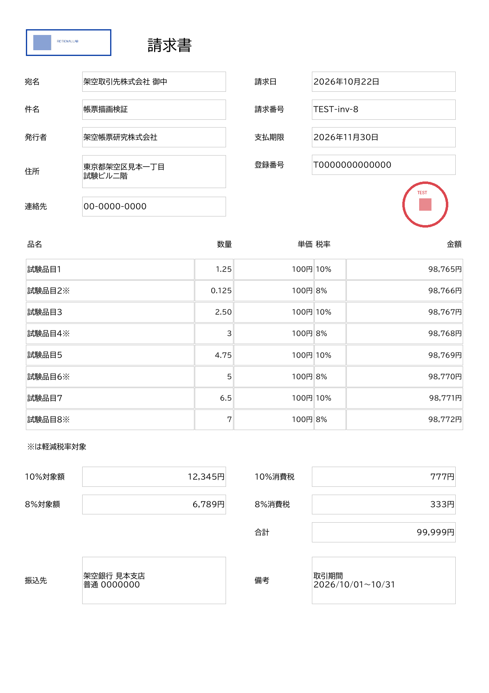
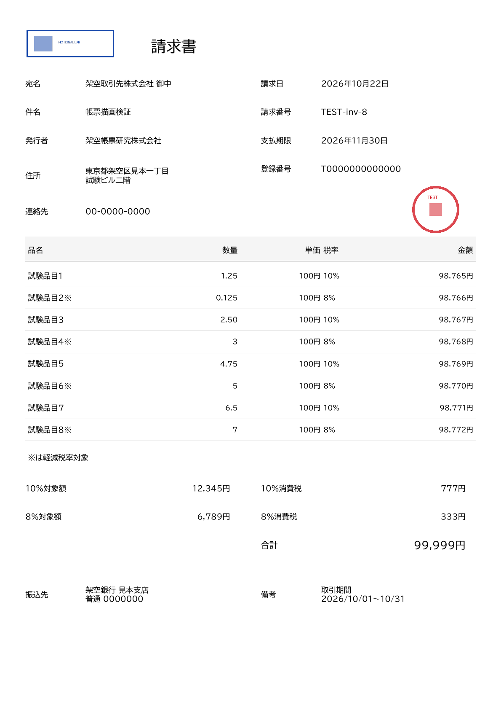
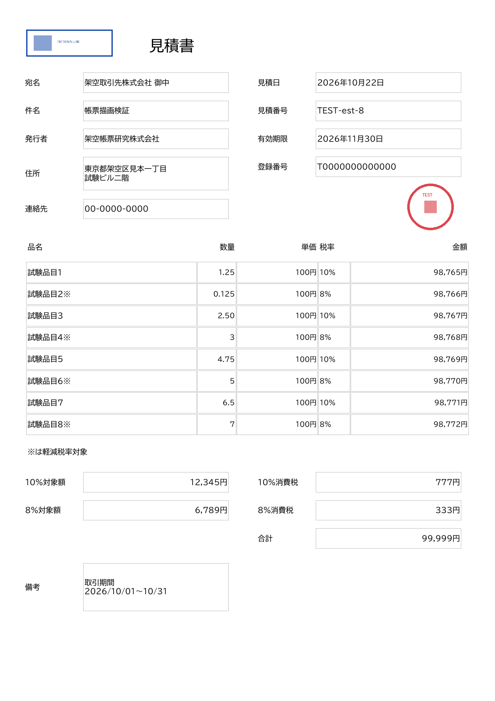
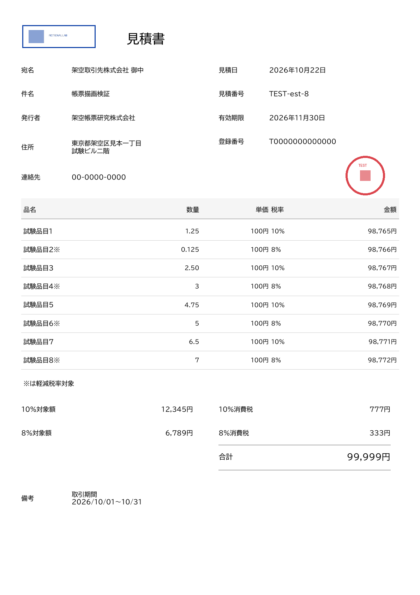

# site #134：採用した罫線整理案・実装引き継ぎ

**成果物共有専用。製品実装・API契約・CI・共有mainは変更していません。** ユーザーは罫線整理案、数量の整数部5桁／小数部3桁・末尾0保持、小数点揃え／右揃えの両モードを用意する方針を採用しました。quantityAlignmentの設定仕様も採用済みで、既定decimal、発行時上書き可、発行値＞登録値＞decimal、登録値不正は正しい発行値があっても拒否します。名称・宛先のnameLines／20文字×2行と会社住所同上、部署・担当者・敬称の宛先2行内表示も採用済み。宛先住所専用欄・旧name併存は初版対象外。取引／備考の共有3行・48文字と配分、請求書transaction必須／見積書任意も採用済み、専用取引欄は初版対象外。#134全体は未完了です。

**追補：残るR1〜R8をユーザーが一括採用。** 必須・税区分・金額上限・数量0／負数・ゼロ表示・文字・入力エラー形式・品質基準の採否も完了。[採用記録](INITIAL-SPEC-ADOPTED.md)／[標準JSONv0.3](standard-json-draft-v0.3/README.md)／[未実施の最終検証F1〜F6](FINAL-VALIDATION-site-134.md)。今回の更新は資料のみで、製品実装・追加PDF／API実行はなし。過去の測定や「未確定」は各検証時点の記録。

- [site担当向け引き継ぎ文](HANDOFF-site-134.md)：変更対象、#134の残作業、テンプレート調整部分／Issue全体の完成条件。
- [採用した取引情報・備考の仕様](TRANSACTION-NOTES-SPEC-PROPOSAL.md)：共有3行／48文字と配分、専用欄の初版対象外、請求書必須／見積書任意と残る確認。**採用済み・製品未実装。**
- [v0.3 nameLinesからの通し検証](standard-json-v03-validation/README.md)：20×2・部署／担当者／敬称、数量両モード／設定、正常18件・拒否66件。比較PDF・再現スクリプトあり。製品未実装。
- [最新の標準JSON案 v0.3](standard-json-draft-v0.3/README.md)：採用したnameLines・名称／住所上限と数量設定、登録／発行例・項目対応・採用エラー形式。R1〜R8も採用済み、最終検証は未実施。
- [旧標準JSON案 v0.2](standard-json-draft-v0.2/README.md)：旧name形式の正常14件・拒否65件を再現する資料。入力・validator・PDFは維持。
- [旧標準JSON案 v0.1](standard-json-draft/README.md)：過去の検証再現用。旧全体5文字制限を現行案へ引き継がない。
- [採用した会社名・宛先仕様](NAME-RECIPIENT-SPEC-PROPOSAL.md)：20文字×2行／nameLines、宛先住所・部署・担当者、旧形式の対象外と残る検証。**採用済み・製品未実装。**
- [標準JSON v0.2候補全体の通し検証](standard-json-v02-validation/README.md)：採用数量・設定解決を含む事前検証→変換→PDF、正常14件・エラー65件を確認。未確定条件は候補として明記。
- [設定解決の検証結果](quantity-resolution-validation/README.md)：正常9件の優先順位と実効モードPDF、不正40件の拒否・API呼び出し0を確認。製品保存／HTTPは未検証。
- [採用した数量モード設定](QUANTITY-MODE-SETTINGS-DRAFT.md)：設定場所・key・既定値・発行上書き／優先順位・不正値のエラーと、残る確認事項。**設計採用済み・製品未実装。**
- [拡張数量欄の両モード比較](quantity-mode-comparison/README.md)：同じ入力から小数点揃え／右揃えを生成。両帳票1／8明細、99999.999・末尾0・隣接欄・抽出一致を確認。**ローカルfixture検証、製品未実装。**
- [数量欄拡張・小数点揃えの比較](quantity-decimal-comparison/README.md)：請求書／見積書の1・8明細、現行数量配置との2ページ比較PDF、末尾0保持・隣接欄・99999.999の追加検証。**数量の桁数・表示は採用済み、製品未反映。検証時点の未確定という記述は過去の記録。**
- [初版の推奨仕様と判断事項](INITIAL-SPEC-RECOMMENDATION.md)：必須・型・上限、取引情報／備考の配分、名称の採用仕様と残る判断点。**採用前の履歴。最新はR1〜R8採用記録を参照、製品未実装。** [名称・住所の追加検証](header-lines-probe/README.md)も参照。
- [標準JSON案からの実描画検証](standard-json-validation/README.md)：請求書／見積書の1・8明細、取引日／期間と備考、確定金額保持、候補入力エラーの再現と実PDF API応答。
- [作業Issue #134](https://github.com/kooiei-in4a/amane-tools-site/issues/134) / [親 #133](https://github.com/kooiei-in4a/amane-tools-site/issues/133)

## PDF・定義ファイル

比較PDFは**1ページ目が現行、2ページ目が整理案**。入力・金額・画像は同じです。

| ケース | 現行PDF | 整理案PDF | 比較PDF | 入力 |
| --- | --- | --- | --- | --- |
| 請求書1明細 | [現行](line-comparison/invoice-1/current.pdf) | [整理案](line-comparison/invoice-1/final.pdf) | [2ページ比較](line-comparison/invoice-1/comparison.pdf) | [表示値JSON](line-comparison/invoice-1/input.display-values.json) |
| 請求書8明細 | [現行](line-comparison/invoice-8/current.pdf) | [整理案](line-comparison/invoice-8/final.pdf) | [2ページ比較](line-comparison/invoice-8/comparison.pdf) | [表示値JSON](line-comparison/invoice-8/input.display-values.json) |
| 見積書1明細 | [現行](line-comparison/estimate-1/current.pdf) | [整理案](line-comparison/estimate-1/final.pdf) | [2ページ比較](line-comparison/estimate-1/comparison.pdf) | [表示値JSON](line-comparison/estimate-1/input.display-values.json) |
| 見積書8明細 | [現行](line-comparison/estimate-8/current.pdf) | [整理案](line-comparison/estimate-8/final.pdf) | [2ページ比較](line-comparison/estimate-8/comparison.pdf) | [表示値JSON](line-comparison/estimate-8/input.display-values.json) |

- [請求書の比較用definition.json](line-comparison/invoice.definition.json)
- [見積書の比較用definition.json](line-comparison/estimate.definition.json)
- [共通背景の整理案PDF](line-comparison/refined-template.pdf)
- 固定版の元資産：[請求書](site-assets/src/Amane.Tools.Site/wwwroot/pdf-templates/invoice/definition.json) / [見積書](site-assets/src/Amane.Tools.Site/wwwroot/pdf-templates/estimate/definition.json)。同ディレクトリに元template.pdfも同梱。
- [比較生成スクリプト](compare-lines.py) / [描画検証スクリプト](reproduce.py)
- [罫線整理案の測定・照合結果](line-comparison/results.json) / [初期描画検証の測定結果](results/results.json)

比較用definitionは背景PDFのSHA256と合計のfontSizeだけを変更した検討用コピー。製品資産への反映は別作業です。GitHubでPDFを表示できない場合はファイル画面のDownload/Rawから取得してください。

## 見た目（8明細）

| 現行 | 整理案 |
| --- | --- |
|  |  |
|  |  |

[index.html](line-comparison/index.html) は取得後、ローカルのブラウザで4ケースを左右比較できます。

## 固定版・確認済み事項

API: `465088ed0b575f055beb6851e98d28ed22fb9928` / site資産: `e08aed241245f9f84a7336302edcb7d6a89a57b1`。

4整理案は各1ページ、qpdf検査成功、欄別抽出が入力・現行版と完全一致。画像の透過・縦横比・配置も確認済み。3回呼び出しは0.574〜0.690秒、最終219,544〜221,533 bytes（CPU 1 / RAM 1536MiBのローカルDocker、各1回）。性能差の評価やsite経由の保証ではありません。Acrobat/pdf.js・実印刷は未確認です。

サンプルは「確定金額を再計算しない」検証用に、数量×単価・税計算と意図的に一致しない金額を使用。実取引用ではありません。全会社情報・画像は架空です。

## 取得・再現

このブランチを既存APIリポジトリの作業コピーで参照するか、ファイルを取得してください。必要な代表入力と元資産を同梱し、比較生成スクリプトを単独で再実行できる配置にしています。

共有ディレクトリで、既存APIソースの固定版を検証用の `api-source` に展開します（共有mainを変更しません）。

```bash
cd docs/evidence/site-134
mkdir -p api-source
git -C ../../.. archive 465088ed0b575f055beb6851e98d28ed22fb9928 | tar -x -C api-source
docker build -t amane-pdf-api:site134-465088e api-source
python3 compare-lines.py --output /tmp/amane-site134-line-comparison-rerun
```

既存依存のDocker、qpdf、Poppler、Python/Pillow/numpyを使用。環境による制約を避けるため検査先は `/tmp` としています。初期描画検証の全ケースを再実行する場合は `reproduce.py --output /tmp/amane-site134-rerun` を使用してください。大規模な検証基盤の追加はありません。

## 引き継ぐ判断

A：既存fill-template 1回＋stamp-image 2回を初期方式として採用可能。

B：罫線・合計強調はsite側のgenerator/PDF/definition/ハッシュ/関連検証を整合させて反映。標準JSON、取引日／期間・宛先情報・長文・画像領域の表示先、8明細と必須・文字・枠の事前検証、項目パス付きエラー、正式な性能基準は #134 の残作業。

C：今回必須のAPI変更は確認なし。可変明細・自動改ページ・一括合成を先行実装しない。テンプレート反映だけで #134 全体を閉じない。
