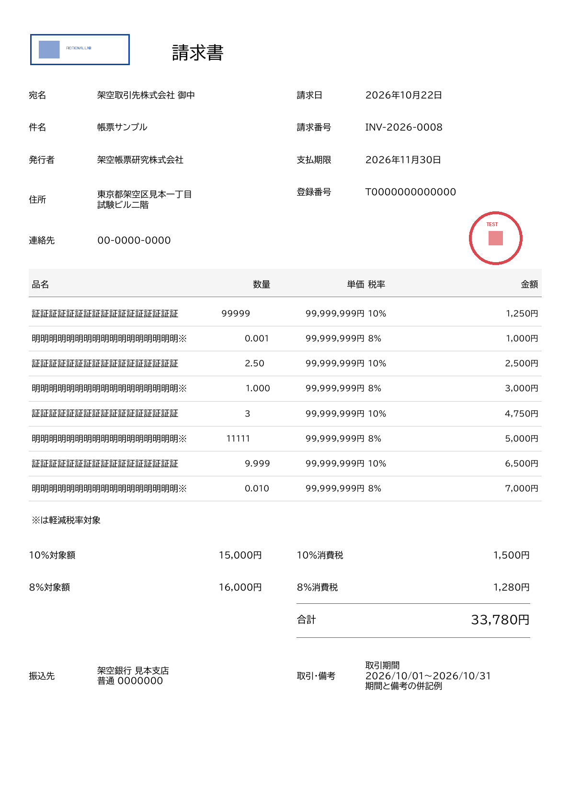
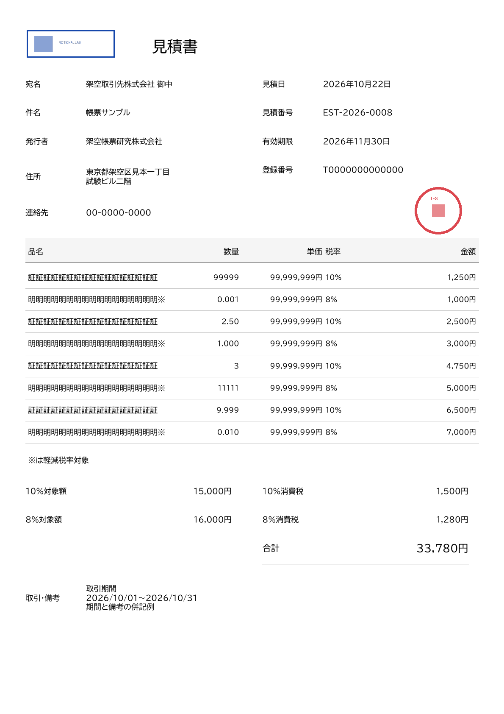
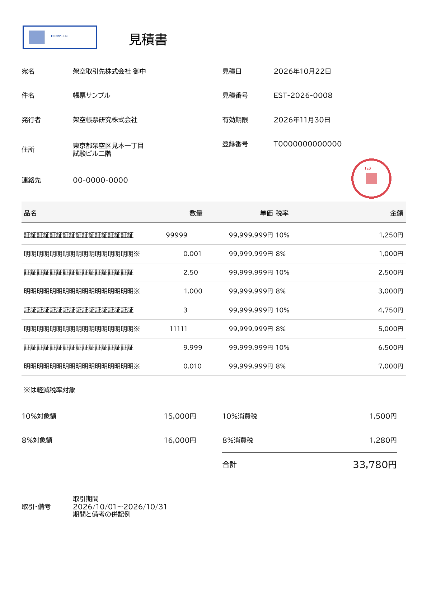

# #134 数量欄の拡張・小数点揃え：比較検証

**検証用コピーのみ。製品コード・API契約・CI・共有mainは未変更。** 数量の配置方式と欄幅の採否、標準JSONの数量上限はまだ確定していない。#133／#134は未完了。

## 比較PDF

比較PDFは**1ページ目＝現行の数量右揃え、2ページ目＝欄幅拡張＋小数点揃え**。両方とも採用した罫線整理背景を使用し、同じ入力・金額・画像で比較する。共有mainの技術検証用囲み罫線は背景として使用していない。前回の名称2行案は今回の比較へ追加していない。

| 帳票 | 現行数量配置 | 小数点揃え案 | 2ページ比較 | 入力 |
| --- | --- | --- | --- | --- |
| 請求書1明細 | [PDF](invoice-1/current/final.pdf) | [PDF](invoice-1/proposed/final.pdf) | [比較PDF](invoice-1/comparison.pdf) | [JSON](invoice-1/request.json) |
| 請求書8明細 | [PDF](invoice-8/current/final.pdf) | [PDF](invoice-8/proposed/final.pdf) | [比較PDF](invoice-8/comparison.pdf) | [JSON](invoice-8/request.json) |
| 見積書1明細 | [PDF](estimate-1/current/final.pdf) | [PDF](estimate-1/proposed/final.pdf) | [比較PDF](estimate-1/comparison.pdf) | [JSON](estimate-1/request.json) |
| 見積書8明細 | [PDF](estimate-8/current/final.pdf) | [PDF](estimate-8/proposed/final.pdf) | [比較PDF](estimate-8/comparison.pdf) | [JSON](estimate-8/request.json) |

| 現行数量配置 | 小数点揃え案 |
| --- | --- |
|  |  |
|  |  |

## 変更した検証用定義・配置

| 対象 | 現行 | 検証案 |
| --- | --- | --- |
| quantity／heading.quantityのセル | x=.4000、幅=.0750（44.625pt） | x=.3800、幅=.0950（56.525pt）。右端.4750は維持。 |
| name／heading.nameのセル | x=.0550、幅=.3400（202.3pt） | xは維持、幅=.3200（190.4pt）。数量セルと2.975ptの間隔。 |
| 数量の文字配置 | 文字列の右端揃え | 小数点の開始位置を共通化。整数はその位置に末尾を揃える。 |
| フォント・他の列 | 数量8pt、品名9pt | 同じ。単価・税率・明細金額やその他の位置も維持。 |

固定フォントの文字幅表を使用し、数量文字列の整数部の幅から開始xを計算する。既存APIのleft配置で**文字列全体を1 fieldとして描く**。分割・空白埋め・0補完・丸め・数値変換はしない。`2.50`、`1.000`、`0.010`を入力表記のまま印字する。

小数点開始の基準は左端から261.469pt。数字1は他の数字より狭いため、文字数ではなくglyph advanceで計算する。座標はAPIの小数4桁へ丸め、最大約0.03ptの丸め誤差に対して右側に0.06ptの余白を設ける。整数部5桁＋小数点＋小数部3桁とAPI余白・丸め余白に必要な幅は51.916ptで、検証案の56.525pt内に入る。

定義ファイルには論理セルを記録し、値ごとに調整した実送信矩形は各`fields.json`／`quantity-placement.json`に保存する。**definition.jsonの幅変更だけでは小数点は揃わず、site側の表示変換でも配置計算が必要。** 新しいalign値やPDF APIの契約は追加しない。

既存実装の根拠：[siteの数量セル・右揃え指定](https://github.com/kooiei-in4a/amane-tools-site/blob/e08aed241245f9f84a7336302edcb7d6a89a57b1/scripts/make-pdf-templates.mjs#L38)、[APIのalign検証](https://github.com/kooiei-in4a/amane-pdf-api/blob/465088ed0b575f055beb6851e98d28ed22fb9928/src/Amane.Pdf.Api/FillTemplateFields.cs#L61)、[文字幅・枠超過・配置計算](https://github.com/kooiei-in4a/amane-pdf-api/blob/465088ed0b575f055beb6851e98d28ed22fb9928/src/Amane.Pdf.Api/FillTemplateFields.cs#L119)。

## 表示・文字抽出・隣接欄

- 8明細の数量は順に`99999`、`0.001`、`2.50`、`1.000`、`3`、`11111`、`9.999`、`0.010`。整数5桁、小数3桁、狭い数字1、末尾0を含めた。1明細は`99999`。
- 隣接欄は品名17文字、8%の行では軽減記号※付き18文字、単価99,999,999円を配置。品名・単価・税率・金額と重ならず、全欄の抽出が送信fieldsと完全一致した。
- 数量以外のwordは文字と実矩形の集合が現行／案で完全一致。品名セルを狭めても文字の位置・サイズ・内容は変わらない。比較4組の`pdftotext -raw`全文もbyte一致。Popplerのbbox列挙順は列配置により変わるため、座標比較ではその順序を使っていない。
- 8明細の**小数点の黒い画素中心は144dpiで全行同じx**。小数点／整数末尾のフォントadvanceによる基準位置の最大差は0.0475pt。現行は小数点画素の位置差6pt、整数末尾も含む基準位置差20.696ptだった。
- 8明細案の実文字の最小間隔は品名との間41.1425pt、単価との間36.679pt。全wordが送信矩形内で、欠けなし。全最終PDFはqpdf検査成功・1ページ。比較PDF4件は各2ページ。
- 比較4組のすべてで数量・確定金額・日付等の欄別抽出が一致。数量や単価を境界値へ変更しても、明細金額・税額・合計は元の入力の確定値を使い、乗算・税計算・合算・金額間の整合性判定はしていない。意図的な不整合を含む架空の描画試験であり、実取引用ではない。
- ロゴ・印影は既存の透過／半透過PNGを同じ位置へ合成。全10最終PDFで画素・縦横比・配置検査成功。144dpiで請求書／見積書8明細、請求書1明細、下記の両追加例を目視確認した。

## 整数部5桁＋小数部3桁を同時に持つ場合

`99999.999`も[請求書PDF](extended/invoice/final.pdf)／[見積書PDF](extended/estimate/final.pdf)で表示・抽出でき、隣接欄へ重ならなかった。他の欄はそれぞれの1明細比較ケースと同じ。今回の幅拡張案で同時の最大桁数にも対応できる。

ただし、**これは標準JSON v0.1案の「数量全体5文字」を超える描画専用の追加検証**。既存fixture validatorは`/items/0/quantity`のquantity-formatで拒否する。[請求書の事前エラー](extended/invoice/preflight-error.json)／[見積書](extended/estimate/preflight-error.json)。このエラーのstatus422はローカル候補契約で、製品HTTP応答の試験ではない。

位置付きfieldsで同じ9文字を元の数量矩形へ直接送ると実PDF APIはHTTP422／field-overflowでPDFを返さず、拡張案は既存APIで成功した。[請求書の元枠エラー](extended/invoice/original.problem.json)／[見積書](extended/estimate/original.problem.json)。現行配置で同じ入力のPDFが生成できないため、この追加2件は比較PDFに混ぜていない。

同時最大桁数まで初版で受け付けるなら、例えば「整数部最大5桁・小数部最大3桁・全体最大9文字」への**標準JSON案の改訂判断**が必要。今回それを確定・製品実装していない。0数量・先頭0・指数表記等の既存候補規則も自動的には緩めない。

## 実測・環境

下表は本資料の完走run各1回。時間はfill-template 1回→stamp-image 2回の最終本文受信まで。JSON読込・事前検証・配置計算・保存・文字抽出・PNG検査は含まない。新方式の性能差を判断する反復試験ではない。

| ケース | 現行3回秒 | 案3回秒 | 案の最終bytes |
| --- | ---: | ---: | ---: |
| 請求書1明細 | 0.706 | 0.580 | 221,483 |
| 請求書8明細 | 0.605 | 0.600 | 222,279 |
| 見積書1明細 | 0.686 | 0.578 | 220,405 |
| 見積書8明細 | 0.597 | 0.585 | 220,748 |
| 追加：請求書99999.999 | 元枠422 | 0.572 | 221,511 |
| 追加：見積書99999.999 | 元枠422 | 0.602 | 220,431 |

API `465088ed0b575f055beb6851e98d28ed22fb9928`、site資産 `e08aed241245f9f84a7336302edcb7d6a89a57b1`に固定。背景は既存`line-comparison/refined-template.pdf`、元のJSON／定義は`standard-json-draft`／`standard-json-validation`の固定共有資料を使用。会社・画像は架空のものだけ。

既存Docker `amane-pdf-api:site134-465088e`、CPU1、RAM1536MiB（追加swapなし）、tmpfs256MiB、read-only、network none、共有2枠／待ち0。docker execのloopback HTTPで、site中継なし。既存qpdf／Poppler／Python／Pillow／numpyとsmoke起動・検証処理を再利用し、新規ライブラリは導入していない。イメージID・glyph表SHA256・各実測は[results.json](results.json)に記録。

記録した完走runは32 POST（10成功チェーン×3＋元枠422×2）。health200、各チェーンとエラー後に既存assert_cleanでjob・子process残存なし。同時実行・長時間負荷・ブラウザ閲覧・実印刷は今回追加検証していない。

## 成果物・再現

[比較生成スクリプト](../compare-decimal-quantity.py)。既存の[成果物環境](../README.md)を準備し、未存在のoutputを指定する。

```bash
python3 compare-decimal-quantity.py --output /tmp/amane-site134-quantity-rerun
```

比較ケースごとにcompany.json／request.json、display-values.json、field-sources.json、quantity-placement.json、current／proposedのdefinition.json・fields.json・field-index.json・final.pdf／png／txt／extracted.json／bbox.htmlを共有。追加例には候補上限エラーと実APIの元枠エラーも含める。ローカルには文字のみ／ロゴ後の中間PDF・PNGも保存。未完走の調整用出力は共有資料に含めない。

## 判断

**A：既存APIで、小数点揃え・入力表記保持・8明細1ページ・透過PNG合成が成立。B：siteのテンプレートセル幅と、固定フォントの文字幅を使う数量配置変換が必要。C：今回必要なAPI変更は確認なし。** APIのdecimal-align追加や一括合成を先行実装する必要はなく、新規API Issueは作成しない。

残作業は、この数量レイアウト案と数量の全体5文字／最大9文字のどちらを初版に採るかを決め、採用する標準JSON・エラー・名称／備考を含む最終定義コピーを同じ版にそろえること。既存の未確定事項も残り、#134を完了扱いにはしない。製品実装は開始していない。
