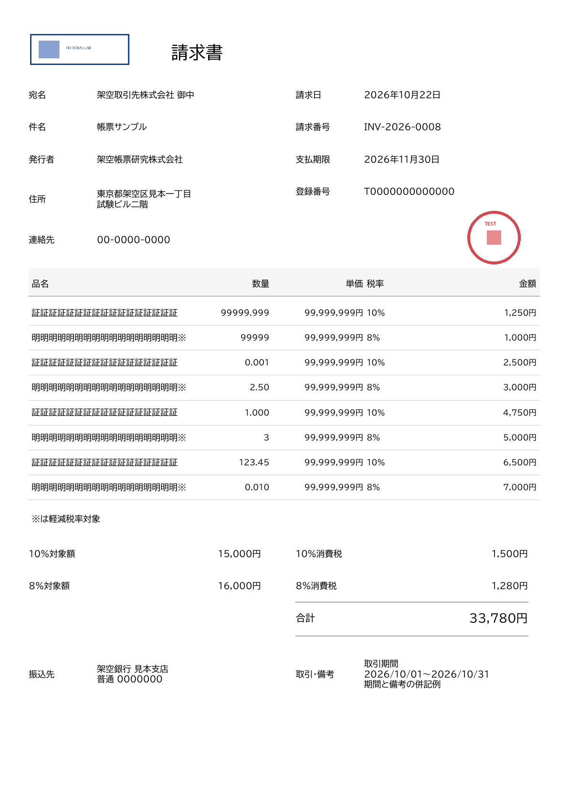
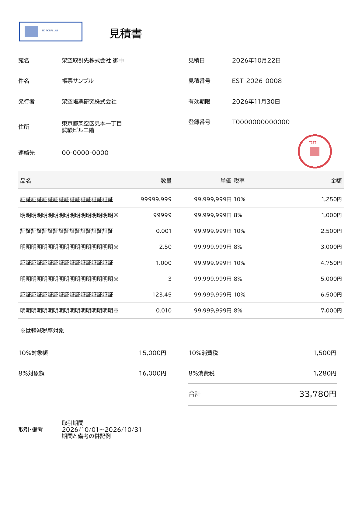

# #134 拡張数量欄：小数点揃え／右揃えの同一入力比較

**後続の採用決定**：[quantityAlignment設定仕様](../QUANTITY-MODE-SETTINGS-DRAFT.md)をユーザーが採用した。既定decimal、発行時上書き可、発行値＞登録値＞decimal、登録値不正は正しい発行値があっても拒否する。以下の設定未確定という記述は描画検証時点の履歴であり、設定解決・エラーは後続の[fixture検証](../quantity-resolution-validation/README.md)で確認済み。以下の未確認記述は比較実施時点の履歴。製品は引き続き未実装。

**検証用コピーのみ。製品実装・API契約・CI・共有mainは未変更。** 数量の両モード・整数部5桁／小数部3桁・末尾0保持は採用方針。設定key・既定値・発行時の上書き可否は未確定のまま、ローカルfixtureで配置だけを切り替えて検証した。#133／#134は未完了。

## 比較PDF・入力

**両モードとも拡張済みの幅56.525ptを使用。** 旧幅の右揃えとの比較ではない。比較PDFは1ページ目＝小数点揃え、2ページ目＝右揃え。同じケースのcompany.json／request.json／display-values.json／definition.json／画像を共用する。

| ケース | 小数点揃え | 右揃え | 比較PDF | 共通入力／定義 |
| --- | --- | --- | --- | --- |
| 請求書1明細 | [PDF](invoice-1/decimal/final.pdf) | [PDF](invoice-1/right/final.pdf) | [2ページ](invoice-1/comparison.pdf) | [JSON](invoice-1/request.json) / [定義](invoice-1/definition.json) |
| 請求書8明細 | [PDF](invoice-8/decimal/final.pdf) | [PDF](invoice-8/right/final.pdf) | [2ページ](invoice-8/comparison.pdf) | [JSON](invoice-8/request.json) / [定義](invoice-8/definition.json) |
| 見積書1明細 | [PDF](estimate-1/decimal/final.pdf) | [PDF](estimate-1/right/final.pdf) | [2ページ](estimate-1/comparison.pdf) | [JSON](estimate-1/request.json) / [定義](estimate-1/definition.json) |
| 見積書8明細 | [PDF](estimate-8/decimal/final.pdf) | [PDF](estimate-8/right/final.pdf) | [2ページ](estimate-8/comparison.pdf) | [JSON](estimate-8/request.json) / [定義](estimate-8/definition.json) |

| 小数点揃え | 右揃え |
| --- | --- |
|  |  |
|  |  |

## 入力・配置条件

- 1明細は両帳票とも数量`99999.999`。8明細は`99999.999`、`99999`、`0.001`、`2.50`、`1.000`、`3`、`123.45`、`0.010`。
- 既存の数量比較の境界fixtureを再利用し、数量だけ更新。品名は17文字、軽減税率の行は※を加え18文字、単価は99,999,999円。会社・画像はすべて架空。明細金額・税額・合計は元の入力値を保持し、数量や単価との意図的な不整合を含む。実取引用ではない。
- [v0.2の定義コピー](../standard-json-draft-v0.2/README.md)を共通に使用。数量はx=.3800／幅=.0950（56.525pt）／8pt、maxLength=9。品名はx=.0550／幅=.3200／9pt。他の列や罫線・画像位置も共通。
- decimalは既存`decimal_fields()`を再利用し、整数部の固定フォントadvanceからxを決め、数量全体を1 fieldでleft配置。基準261.469pt、丸め余白0.06pt。rightは拡張セルへそのままalign=rightで送る。
- 切替で変えたのは数量fieldsのx・width・alignのみ。入力文字列・その他のfieldの全propertyは同一。入力JSONのSHA256を各モードの結果へ記録し、処理前後でも不変を確認した。

各モードの`mode.json`は検証スクリプト用の指定で、製品の設定登録API／発行JSONへquantityAlignmentを実装したものではない。

## 表示・抽出・隣接欄の結果

全8最終PDFはqpdf検査成功・1ページ、全欄の抽出が送信fieldsと完全一致、矩形外word 0。比較4 PDFは各2ページ。各モードで入力の数量・品名・単価・税率・確定金額を抽出結果と独立に照合し、各ケースの`confirmed-values.json`に期待値を保存した。

| 確認 | 結果 |
| --- | --- |
| `99999.999` | 請求書／見積書の1・8明細、両モードで表示・抽出成功。旧5文字制限へ戻らない。 |
| 末尾0 | `2.50`／`1.000`／`0.010`をそのまま保持。空白埋め・0補完・丸め・短縮なし。 |
| decimalの位置 | 8明細の小数点画素中心は144dpiで全行同じx。整数末尾も含む基準位置の最大差0.0475pt。 |
| rightの位置 | 8明細のword右端は全行282.225ptで一致（最大差0pt）。小数点位置を揃えない、当初の表示方式。 |
| 数量以外 | 両モードでwordの文字・実矩形の集合が完全一致。品名・単価・金額・合計等を移動していない。 |
| 全文／欄別抽出 | 4組すべてで欄別の抽出内容、`pdftotext -raw`全文がbyte一致。bbox列挙順に依存しない座標照合も実施。 |
| 隣接欄 | 非交差。8明細decimalの最小間隔は品名側35.9065pt／単価側36.7075pt。rightは品名側44.994pt／単価側36.639pt。 |
| 確定金額 | 各明細・単価・税率別対象額／税額・合計を入力どおり表示。乗算・税計算・合算・金額間整合性判定なし。 |
| 画像 | 全8件で既存の透明／半透明PNGロゴ・印影を文字後に合成。画素・比率・配置・透過の検査成功。 |

144dpiで請求書8明細の両モード、見積書8明細右揃え、見積書1明細小数点揃えを目視し、文字・罫線との衝突や欠けなし。1明細の同時最大値は小数部3桁で両モードの末尾がほぼ同じ位置になるため、配置の違いは8明細の混在例で比較できる。

## 時間・サイズ

各モード1回ずつのローカル測定。時間はfill-template 1回→stamp-image 2回の最終本文受信まで。JSON読込・fixtureの検査／マッピング・保存・描画／抽出検査は除く。性能差を判断する反復試験ではない。

| ケース | 小数点揃え秒 | 右揃え秒 | 小数点揃えbytes | 右揃えbytes |
| --- | ---: | ---: | ---: | ---: |
| 請求書1明細 | 0.763 | 0.652 | 221,511 | 221,512 |
| 請求書8明細 | 0.663 | 0.683 | 222,279 | 222,285 |
| 見積書1明細 | 0.713 | 0.657 | 220,431 | 220,432 |
| 見積書8明細 | 0.860 | 0.798 | 220,748 | 220,753 |

固定版：API `465088ed0b575f055beb6851e98d28ed22fb9928`、site資産 `e08aed241245f9f84a7336302edcb7d6a89a57b1`、基礎の成果物commit `04058831200acbdf3a046271da03dbffca77453b`。CPU1、RAM1536MiB（追加swapなし）、tmpfs256MiB、read-only、network none、共有2枠／待ち0の既存Docker。docker execのloopback HTTPで、site中継なし。イメージID・スクリプト／背景／入力のSHAと全実測は[results.json](results.json)に記録。

24 POST（8成功チェーン×3）、health200。各チェーン後の既存assert_cleanでjob・子process残存なし。既存Python／Pillow／numpy／Poppler／qpdf、既存smoke・文字抽出・画像照合・位置測定を再利用し、新規依存は追加していない。

## 再現・成果物

[比較スクリプト](../compare-quantity-modes.py)。既存[成果物環境](../README.md)を準備し、未存在のoutputを指定する。

```bash
python3 compare-quantity-modes.py --output /tmp/amane-site134-quantity-modes-rerun
```

各ケースの共通ファイル：company.json、request.json、display-values.json、definition.json、confirmed-values.json、comparison.pdf。各モード：mode.json、fields.json、field-index.json、quantity-placement.json、final.pdf／png／txt／extracted.json／bbox.html。ローカルには文字のみ／ロゴ後の中間PDF・PNGも残す。共有版は最終PDFと再現資料を掲載。

## 判断と残る範囲

**A：既存APIで、拡張セルの両モード・同時最大数量・末尾0・固定8明細1ページ・透過PNG合成が成立。B：siteで設定契約を決め、decimalの文字幅による配置／rightの既存配置へ振り分ける表示変換が必要。C：具体的なAPI変更の必要性は確認なし。** 新規API Issueは作成しない。

今回の入力は既存の境界fixtureと表示値を再利用し、数量の型・桁数を検証した後に数量fieldsだけを更新した。**標準JSON v0.2全体の必須・未知key・参照等を新validatorで検証する一連の試験ではない。** mode.jsonもローカルfixtureの切替で、製品設定の保存／読込・既定値・発行時override・不正モード値の製品エラーは未確認。モード選択の設定key・既定値等、その他の名称／取引・備考・品質／性能基準は引き続き#134の残作業。

同時実行・長時間負荷・ブラウザ閲覧・実印刷・認証／保存は今回追加検証していない。製品実装と共有mainは変更せず、描画確認だけで#134を完了扱いにしない。
