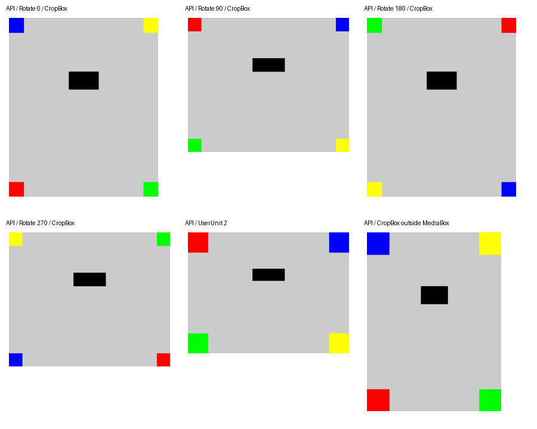

# 黒塗りAPIの検証記録（PR B、2026-10-16）

main `d2ce7ff`（PR A #66）から実装。qpdf 12.3.2、pdfcpu 0.16.1、PDFium chromium/8100、libjpeg-turbo 2.1.5、.NET 10.0.12。§13の設計調査時の記録は書き換えず、実装の結果をここに記録する。

## 自動検証

- Releaseの単体・実tool・HTTPテスト。regionsの形式・境界、decimalによる外側丸め、フォント共有（直接/間接、DescendantFonts、異なるdescriptorから同じprogram、Form/Pattern/SMask/Type3、連鎖しない判定）、画像filter列・成分数・mask、深さ32・訪問100万、容量台帳、最終update JSONを検証する。
- 本文・フォーム・注釈・添付・しおり・タグ・文書情報・ページラベルの目印をQDF展開した出力から検索し、`MK_*`がなく、対象外ページの`PUBLIC_*`が残ることを確認する。外観付きFileAttachmentは対象外ページに置く。
- pdfcpuで作る共有日本語フォントの2ページ文書を使い、2ページ目も画像になり、元のToUnicode/FontFileを含む共有フォントが出力から消えることを確認する。NeedAppearancesのフォーム値は対象外ページの本文として残る。
- 刈り込みの実警告を422にするテストは、元fixtureが入力の`--check`でも警告するため、その最初のチェックだけwrapperで通過させる。通常のAPIではその入力は最初の検査で既存422になる。刈り込み自体は実qpdfで実行する。部分出力がFSIZEに達し、刈り込みが2または3で終了する場合も`unsupported-pdf`を優先するテストを追加した。
- 最終update JSONを故意に変更し、content・catalog・image・Annots・Contents配列の破損をqpdfが受け付けても500となり、PDF・成功ヘッダーが送られないことを確認する。
- HTTPの成功ヘッダー・固定ファイル名、400 / 413（長さ既知・未知）/ 422の全reason / 描画枠503 / 実描画子プロセスの504・cancel、各経路のjob削除を確認する。timeout/cancelではPID消滅と枠の返却も確認する。設定の0・標準値超過・入力を置けないjob予算は起動時に拒否する。
- Docker build、docker-smoke（黒塗り1件を追加）、renderer-validation、redact-validation。Poppler・Pillow・NumPyは検証側だけに置く。

## 表示上の範囲（Docker → Poppler）

`gen_geometry.py`のRotate 0/90/180/270・ずれたCropBox・UserUnit 2・MediaBox外のCropBoxを使う。APIに順不同で6ページを指定し、昇順ヘッダーを確認する。出力をPopplerで72dpi描画し、四隅の色・範囲内の黒・範囲直外のグレーを画素で検査する。



## 元の本文へ戻る私的参照

設計どおりの初期実装では、対象外ページの`/Private`が対象ページのcontent streamを参照するとHTTP 200となり、元の本文がQDFに残った。この経路はResourcesの刈り込みでは消えない。PR Bで、R以外のページに残る任意の参照をたどり、Rの元page/content、Tのフォント配下の間接objectへの到達を422 `unsupported-pdf`にする検査を追加した。`/Type /Catalog`を持つ別objectを経由する場合も拒否する。qpdfが先に正規化して参照を消すPages辞書のケースは、成功時に元の本文が出力にないことも検証する。

画像化集合の式は承認済みのまま維持する。エラーのreason名・title・ヘッダー名はサイト側の契約から変更しない。出力にはページ一覧外のPage objectがないことも検証する。

## 容量・同時実行（手動）

CPU 1、memory 1.5 GiB、swapなし（memory-swap=memory）、tmpfs 256 MiB、read-only、network none、非root、cap-drop ALL、no-new-privileges。fresh containerの`memory.peak`と`memory.events`を読む。tmpfsは検証専用Cプログラムでstatvfsを1 ms間隔で観測した最大値で、カーネルの厳密なhigh-water値ではない。このobserverのメモリもcgroup peakに含む。

入力は30ページが1つの埋め込みBIZフォントと300dpi A4画像を共有する合成PDF。1〜20ページを指定して30ページを画像化する。30 MiBちょうどにするため、非圧縮性の合成paddingを文書単位のstreamに置く（黒塗り時に除去される）。結合用は各25 MiBの2入力で、各ページのPieceInfo配下にpaddingを置き、約50 MiBの出力も発生させる。結合は最初のJPEG生成を観測してから開始し、30ページの描画ループと重ねる。任意の30 MiB文書の最悪ケースを表す測定ではない。

| 実行 | 黒塗り時間 | 結合時間 | cgroup memory.peak | tmpfs観測最大 |
| --- | --- | --- | --- | --- |
| 単独 | 7,334 ms | — | 132,685,824 bytes（126.54 MiB） | 62,918,656 bytes（60.00 MiB） |
| 50 MiB結合と同時 | 8,350 ms | 1,551 ms | 263,102,464 bytes（250.91 MiB） | 112,259,072 bytes（107.06 MiB） |

黒塗りは両方HTTP 200・出力25,906,177 bytes、結合はHTTP 200・出力52,428,480 bytes。OOM・OOM killとも0、ENOSPCなし。終了後のjobと描画プロセスは0。[生の測定値](redact-validation/redact-capacity.json)。時間はuploadと応答取得を含むdriverのwall time。

## 画像XObjectの閾値（手動）

同じコンテナ制限で、DATA 384 MiB・出力4000×4000（1600万画素）・JPEG品質85のrendererを直接起動する。ページは1440×1440 pt、画像の下を青で塗り、灰色の外周と暗い中央の両方の画素を検査する。省略時の青や、全面が黒い出力を成功とみなさない。表の時間は描画子プロセスの起動から終了まで。peakはfresh cgroupで、fixtureをPDFに変換するqpdfも含む。[測定値](redact-validation/redact-thresholds.json)。

| 画像 | 幅×高さ | APIの検査サンプル数 / JBIG2画素 | ms | memory.peak bytes |
| --- | --- | --- | --- | --- |
| `dct-baseline90` | 4000×7500 | 90,000,000 | 349 | 162,906,112（155.36 MiB） |
| `dct-progressive90` | 4000×7500 | 90,000,000 | 537 | 341,864,448（326.03 MiB） |
| `dct-gray90` | 9000×10000 | 90,000,000 | 468 | 273,346,560（260.68 MiB） |
| `jpx-rgb30` | 2000×5000 | 30,000,000 | 457 | 223,543,296（213.19 MiB） |
| `jpx-gray30` | 5000×6000 | 30,000,000 | 412 | 223,064,064（212.73 MiB） |
| `jpx-rgba30` | 2000×5000 | 30,000,000 | 708 | 315,568,128（300.95 MiB） |
| `jbig2-1000` | 40000×25000 | 1,000,000,000 | 1023 | 320,245,760（305.41 MiB） |
| `dct-cmyk90` | 3000×7500 | 90,000,000 | 1468 | 341,102,592（325.30 MiB） |

JPX RGBAはPDF辞書のDeviceRGBに従う3成分の3,000万サンプルで判定し、符号化データはalpha込み4,000万サンプル。CMYKは`Decode [1 0 ...]`付きとし、色変換後のRGB値がDATA 768 MiBの参照描画と一致することを確認した。

**元の閾値では不十分だった。** progressive RGB 1億2,000万サンプルはDATA 384 MiBで終了0でも中央・外周がともに黒になり、768 MiBでは期待色を描いた（peak 432,427,008 bytes）。JPX RGB 6,000万サンプルは384 MiBで画像が消えて青い下地が露出し、768 MiBでは描いた（peak 376,950,784 bytes）。[失敗と参照描画の測定値](redact-validation/redact-threshold-failures.json)。このためDCTを9,000万、JPXを3,000万へ下げ、JBIG2は10億画素を維持した。baseline/progressiveを構造JSONだけで区別できないためDCT共通上限とする。

実符号化データのbaseline/progressive・JPX Gray/RGBA・JBIG2の境界をhostのAPIテストでも描画し、JPEGの中央・外周を検査する。同じfixtureのPDF辞書の幅を1画素増やすと422 `too-complex`になることを確認する。この超過テストは事前検査のテストで、巨大画像をもう一度符号化したものではない。

合成画像による確認は、任意の符号化データの描画成功を保証しない。巨大なinline image、壊れたstream、対応外機能による省略は残るため、結果の確認が必要。

## 再実行

```bash
dotnet build --configuration Release
dotnet test --configuration Release
docker build -t amane-pdf-api:redact-validation .
python3 scripts/docker-smoke.py amane-pdf-api:redact-validation
python3 scripts/renderer-validation.py amane-pdf-api:redact-validation
python3 scripts/redact-validation.py amane-pdf-api:redact-validation \
  --artifacts /tmp/redact-results --capacity
python3 scripts/redact-thresholds.py amane-pdf-api:redact-validation \
  --work /tmp/redact-thresholds \
  --jbig2-encoder /absolute/path/to/jbig2 \
  --cases dct-baseline90,dct-progressive90,dct-gray90,dct-cmyk90,jpx-rgb30,jpx-gray30,jpx-rgba30,jbig2-1000 \
  --reference
```

hostテストのtool/font/PDFium環境変数と、qpdfの一時コピーはCIと同じ設定を使う。手動driverにはhostのqpdf・Poppler・Pillow（OpenJPEG対応）・NumPy・gccが必要。JBIG2生成は検証側のjbig2enc 0.30のみで行い、配布imageへは入れない。閾値の旧値の再現は`--cases dct-progressive,jpx-rgb60 --reference`で行う。通常CIは容量測定を繰り返さず、実符号化のhostテストとDockerの画素比較を実行する。
