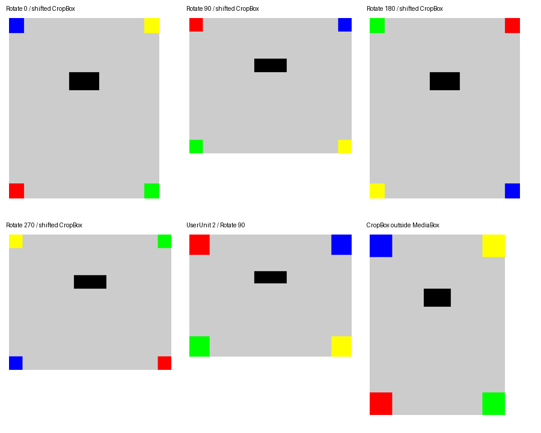

# PDFium描画基盤（Issue #35 PR A）の検証

2026-10-16 JSTに実施したPR Aの別プロセス描画・起動検証・制限の記録です。この時点では黒塗りendpointはまだありませんでしたが、後続のPR BはPR #67として2026-10-17にmainへmerge済みです。黒塗りAPIの実装・検証は[redact-validation.md](redact-validation.md)を参照してください。設計調査時の§13と`redact-design-probe/`は当時の記録として保持します。

## 自動検証

- Release build / 全.NETテスト。新規の PdfRendererTests は52件。
- 実PDFiumで Rotate 0/90/180/270、ずれたCropBox、MediaBoxからはみ出すCropBox、UserUnit 2を描画。四隅のRGB、塗りの内部全画素、4方向の外側をJPEGの誤差込みで照合する。
- expect-sizeの不一致は12、許容差0.01 ptとJPEGのbytes上限同値は成功、上限の1 byte超過・予算1 byteは10で出力なし。文書3、ページ4、bitmap5、JPEG6、引数2、self-test20を実プロセスで確認し、全終了コードのAPI側分類も検査する。
- self-testの日本語は埋め込みなしの /MS-Mincho・/UniJIS-UCS2-H。暗い画素・塗り・JPEGを確認し、ファイルを作らない。Dockerでは通常の render-jpeg でも日本語を描き、文字領域の暗い画素を数える。
- 本番DATAを64 MiBへ下げると、4000×4000のbitmap確保に失敗して5。384 MiBへ戻すと同じ入力が成功する。
- 実rendererがFIFOの入力を開いて待つ間に /proc/PID/limits を調べ、DATA soft/hard=402653184、FSIZE soft/hard=1000001、CORE soft/hard=0、AS=unlimitedを確認する。environで DOTNET_EnableDiagnostics=0 も確認する。明示cancelとdeadline超過の両方でPIDが消え、job directoryも残らない。
- RenderSlotは待ち0・1枠、leaseの二重Disposeでも枠が増えない。
- Docker smokeで日本語レイヤーを描画・黒塗りしてJPEG生成、0600、削除を確認する。既存APIの33件のPOSTも通す。
- Dockerでlibpdfium.soは0444、日本語TTFのsha256、LICENSEとlicenses/17件の存在を検査する。PDFium欠落・空フォントdirでAPIは待受前に停止し、固定ログだけを出す。空フォントdirでは終了コード1を確認する。

比較画像（黒塗りの公開APIではなく、render-jpegの出力）:

## FSIZEの設計修正

設計の「dotnetの起動前からmax-bytes+1」をそのまま使うと、小さい予算でCoreCLRが起動しなかった。PDFは開いていない。

| 起動前のFSIZE | self-testの結果 |
| --- | --- |
| 1 byte | CoreCLR起動失敗、137 |
| 64 KiB | CoreCLR起動失敗、137 |
| 1 MiB | CoreLib/メモリ確保失敗、137 |
| 8 MiB | 成功、0 |
| 30 MiB + 1 | 成功、0 |

.NETのW^X用memfdに起因するため、W^Xを無効にせず、外側のprlimitでは max(max-bytes+1, 8 MiB) を使う。render-jpegは引数検証後、PDFiumのload・入力のopenより前にlibc setrlimitでFSIZEのsoft/hard両方をmax-bytes+1へ下げる。失敗したらPDFを開かず終了する。self-testには出力がないため起動用の8 MiBを使う。

実際の描画PIDの /proc 検査と、max-bytes=1で10・出力なしの回帰テストで確認した。docs/redact-design.md §4.3の本文だけを修正し、§13は変更していない。これは設計からの変更で、Human未確認。

## 時間とmemory.peak

製品image、CPU 1・memory 1536 MiB・memory-swap 1536 MiB（swapなし）、tmpfs 256 MiB、non-root、read-only、network none、cap-drop ALL、no-new-privileges。DATA 384 MiB、CORE 0、診断無効。Ubuntu 26.04、.NET runtime 10.0.12、qpdf 12.3.2、libturbojpeg 2.1.5、PDFium chromium/8100。

設計調査の gen_perf.py・mkpage.py と同じ300dpiスキャンfixture・cjpeg品質90を使う。各サンプルを新しいコンテナ/cgroupで3回ずつ測定した。時間は制限付きrendererの起動直前から終了まで。memory.peakはコンテナ全体で、入力生成のqpdf・shell・page cache・tmpfsも含む。APIの同時稼働はこの測定に含まない。

| 描画 | 全体時間（3回） | memory.peak（最小〜最大） | JPEG | 設計§13.2（CPU 1・512 MiB） |
| --- | --- | --- | --- | --- |
| A4、1654×2339 | 155 / 166 / 158 ms | 67.3〜67.8 MiB | 879,371 B | 152 ms、66 MiB、879,371 B |
| 1600万画素、4000×4000 | 295 / 285 / 285 ms | 137.1〜137.9 MiB | 3,746,065 B | 281 ms、136 MiB、3,746,065 B |

JPEGのbytes数は設計時と一致した。メモリ上限が異なる比較であり、速度差の厳密な評価ではない。任意PDFの成功や表示の完全性の保証には使わない。全サンプルは [renderer-measurements.json](renderer-validation/renderer-measurements.json)。

再現:

~~~bash
docker build -t amane-pdf-api:issue35-renderer .
dotnet build --configuration Release
dotnet test --configuration Release
python3 scripts/docker-smoke.py amane-pdf-api:issue35-renderer
python3 scripts/renderer-validation.py amane-pdf-api:issue35-renderer \
  --artifacts /tmp/renderer-artifacts --measure
~~~

hostの設定はREADME「開発環境」の固定tool導入手順を使う。Docker比較/測定のdriverだけPillow・NumPyを使用し、runtimeへ追加しない。hostのqpdfが拡張子なし出力をAppArmorで拒否する場合は、CIと同じ一時コピーをPATHへ置く。

## 当時PR Bに残していた検証（後続PR #67で実施）

画像サイズの事前検査、ページ数・容量台帳・出力構造の安全性、公開APIのHTTP契約、30ページ画像化と50 MiB結合の同時実行は、記録時点ではPR Bの範囲でした。これらの実装・検証は[redact-validation.md](redact-validation.md)に記録されています。この文書の描画基盤単体の測定と、後続APIの検証範囲を混同しないでください。
