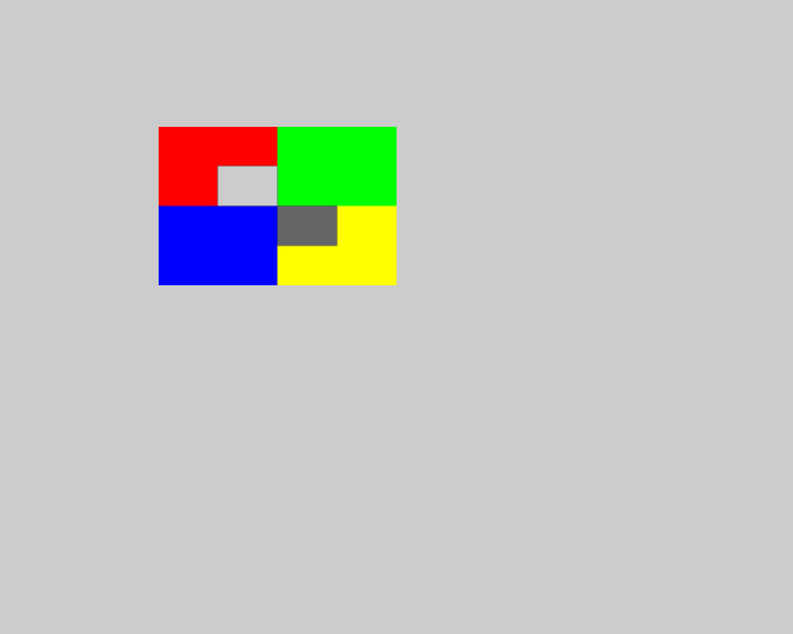

# 電子印鑑APIの検証記録

2026-10-13 JST。Issue #29、main `74ff1ea`を基準にした`feat/issue-29-stamp-image`の実装を検証した。固定toolはpdfcpu 0.16.1・qpdf 12.3.2。Docker imageは`amane-pdf-api:issue29`（ID `sha256:1b110e5f957016e4d81ced1be9100bd00e74ea423848c864f41ef3a504aa4607`）。

## 実装と自動テスト

`POST /api/pdf/stamp-image`がPNG1個を指定ページの表示上の左上原点・割合で配置する。CropBox・Rotate・UserUnitは既存overlay基盤で反映し、対象外ページと属性を保つ。PNG構造・CRC・各辺の上限に加え、IDATのzlib header・Adler-32・filter・行数とbytesの過不足を検査する。tRNS・palette・alpha・16 bit・Adam7に対応する。

- Release build：警告0・エラー0。
- 既存APIを含むRelease全テスト：1063件PASS（失敗0・skip 0、4分11秒）。
- #29のテストは配置行列、全PNG depth/color type・Adam7、壊れたzlib/CRC/Adler・末尾欠損、各辺、query、multipart、50 MiB + 1 MiBの受付、Content-Lengthあり/なしの413を確認する。
- PNG 1 MiB以下でもレイヤー8 MiBを超えるUp filter画像を実pdfcpuへ渡し、422 `image-too-complex`を確認する。入力不正、PDF起因の422、toolのexit 1/2/126/127/137と500を区別する。
- 入力検査・stamp描画・overlayの各段階でtimeout/cancel/アプリ停止を注入し、子processの終了と印影を含むjob削除を確認する。共有同時枠・503・枠の解放も確認する。
- Docker smoke：PASS。押印成功・固定ファイル名・qpdf --check、非PNGの422を追加した。全体33 POST checksのほか既存compress/clean/splitの検証も成功した。

## 描画比較

実APIへCropBoxのずれを持つPDFを送り、Rotate 0/90/180/270 × UserUnit 0.5/1/2 × RGBA 8 bit / RGBA 16 bit Adam7の24ケースを確認した。PDFの画像・Formの配置行列は.NETのテストで表示座標へ変換し、左上・右上・左下の3点を1 pt以内で比較する。描画はCI専用Poppler（144 dpi）を使う。

非対称の四隅（赤・緑・青・黄）の位置・向きを確認し、灰色の下地上で完全透明の画素が204、alpha 128の黒が102となることをRGB許容差3以内で確認した。対象外ページは灰色の元本文を保持した。全24ケースPASS。結果は[JSON](stamp-image-render-results.json)に記録する。

Rotate 90の代表例（左上の赤領域内が完全透明、右下の黄色領域内が半透明）：



その他の[0度](stamp-image-rotate-0.png)、[180度](stamp-image-rotate-180.png)、[270度](stamp-image-rotate-270.png)も同じ表示上の位置・向きになった。

## 最大入力の同時2件

通常CIの描画比較と分け、1 CPU・memory 1536 MiB・swapなし・tmpfs 256 MiB・read-only root・non-root・network noneのDockerで実HTTPを同時2件実行した。

| 項目 | 実測 |
| --- | --- |
| PDF | 52,428,800 bytes、50,000 reachable object、1,000ページ |
| 入力metadata | 33,030,150 bytes（32 MiB以内） |
| PNG | 1,048,576 bytes、2000×2000 px、16 bit RGBA Adam7 |
| 対象 | 1000ページ目、x/y=0.2、width=0.5 |
| 結果 | 2件とも200、出力各52,385,464 bytes |
| 時間 | 20.191秒 / 20.150秒（upload・downloadを含む、各24秒以内） |
| cgroup memory.peak | 745,349,120 bytes（約710.8 MiB） |
| OOM / OOM kill | 0 / 0 |
| 残存job / qpdf・pdfcpu・prlimit | 0 / 0 |

API・子process・tmpfsはcgroup計測に含む。host側の測定driver・入力生成・応答保持のメモリは含まない。tmpfsは256 MiBに制限し、個別jobの124 MiB予約はAPIの台帳で制限する。tmpfsの使用量ピークを別途サンプリングした値ではない。結果は[JSON](stamp-image-capacity-results.json)に記録する。この結果は使用した合成入力の測定であり、任意PDF・PNGの成功時間を保証しない。

## 再現

```bash
dotnet build --configuration Release
dotnet test --configuration Release
docker build -t amane-pdf-api:issue29 .
python3 scripts/docker-smoke.py amane-pdf-api:issue29
python3 scripts/stamp-image-validation.py amane-pdf-api:issue29 --output /tmp/stamp-image-validation
python3 scripts/stamp-image-validation.py amane-pdf-api:issue29 --capacity --output /tmp/stamp-image-validation
```

hostテストには既存CIと同様に固定pdfcpu・日本語フォント・qpdf・libjpeg-turboを用意し、`Pdf__PdfcpuPath` / `Pdf__PdfcpuConfigDir`を設定する。Ubuntu hostのAppArmorがqpdfの拡張子なし出力を拒否する環境では、CIと同様に配布qpdfの一時コピーをPATHへ置く。Pythonの描画比較はPoppler・Pillow・NumPyを検証環境にだけ用意する。runtime Dockerfile・依存は変更していない。

## 残る接続確認と制約

- pdf.js・Acrobatでの表示は未確認。pdfcpuが付けるOCG/Artifactはそのまま合成する。Popplerでは表示される。サイト#44のブラウザ受け入れ確認で扱う。
- サイト#44はrequest上限53,542,912 bytesと`image-too-complex`の許可・伝達が必要。サイトのコード・UIはこの変更に含めない。
- 電子印鑑には電子署名・改ざん防止・本人確認の効力はない。metadataのICC・gamma除去により色がわずかに変わる場合がある。
- セルフレビューで、入力検査の重複、印影の台帳未計上、JSONを使わない描画のCommit、stdout超過の判別、桁数・非ASCII数字・scaleの丸め、child終了待ちとcleanup、他endpointの上限を確認した。
