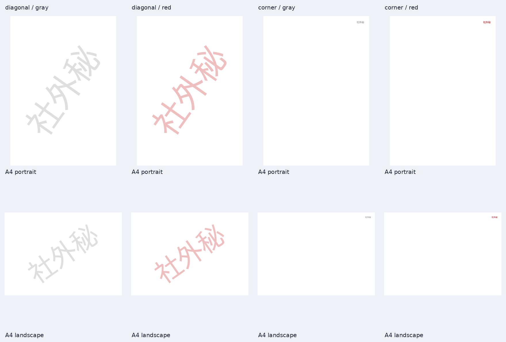

# 透かしAPIの検証記録

2026-10-13、main `24020c5` を基点にIssue #28の `POST /api/pdf/watermark` を実装・検証しました。合成fixtureのみを使っています。

## 確定した仕様と方式

Human指定により、固定fontに字形がない文字と空白だけのtextは400、cornerは横幅に収まらない場合に縮小します。trim・正規化はしません。

fileとtext各1件をstreaming multipartで読み、textは121 byteのバッファで120 bytesまでを受け付けます。upload完了後かつtool起動前にstrict UTF-8、1〜30 text element、許可範囲、字形収録を検査します。queryはupload前に検査します。

Builderが入力検査とmetadata取得を1回だけ行い、表示上の物理寸法で白紙を作り、pdfcpu createとqpdf overlayで本文の前面へ描きます。diagonalの白紙には固定ExtGState `/AmaneAlpha`（ca/CA=0.25）とページごとの独立streamを置きます。pdfcpuはstreamへ追記するため、共有すると他ページの文字が混入します。透過指定がない既存の白紙生成形式は維持します。

字幅はASCIIを固定TTFのadvance / 2048、半角カナを0.5 em、残りを1 emの上界としてRune単位で合計します。pdfcpuのASCII幅は1/1000 emへの切り捨てで、TTF由来の上界との差は0.001 em未満です。diagonalは回転後の外接矩形80%、回転前の幅・高さ95%の4制約で決定します。cornerは14 pt以下、余白28 pt、どちらも最小1 ptです。

## 実測で補正した前提

- `DRAFT`の固定TTFのadvance合計は7618/2048 emです。事前設計の7414/2048を訂正しました。
- `A` + U+3099を30組にすると30 text element・120 bytes・60 Runeです。最大40 Runeという事前設計の前提を60へ訂正しました。1ページ1要素・60 UTF-16単位は既存128単位の上限内、使用glyph数もToUnicodeの先頭100 glyph制限以内です。
- pdfcpuは文字を描かない初期化用BT/ETも生成します。文字混入の回帰検査では各ページのTjが1個であることを確認します。
- 句読点・英字・日本語の混在では、見える字形の外接矩形の中心と文字枠の中心が一致しません。例としてA4縦の `-DRAFT, 社外秘` の画素外接矩形の中心はx方向へ約8.4 ptずれますが、変換行列から求めた文字枠は中央にあります。枠の配置と字形の偏りを分けて検査します。

## 検証環境と結果

- .NET SDK 10.0.401、Release build成功（warning/error 0）。全1,036テスト成功。
- pdfcpu 0.16.1、qpdf 12.3.2、BIZ UDPゴシックv1.051。font SHA-256は `third_party/pdfcpu.lock` の `595dfefa96dcb281c40f5d560841f3fc623b0d9d12064481a7daf78044462673` と一致します。
- 本番Dockerfileのbuildと、透かしを含むDocker smoke（31 POST）成功。non-root、read-only、tmpfs 256 MiB、CPU 1、memory 1.5 GiB（swapなし）、共有の終了待ち・job削除・healthを確認しました。
- `watermark-validation.py` は6文字列 × 2 style × 2 colorの24 HTTP request、12ページずつ計288ページをPoppler 144 dpiで検査します。全面黒画像、A4縦横、Rotate 90/180/270、CropBox原点ずれ、crop+270、UserUnit 2、B5、はがき、100×100、200×2000を含みます。
- 変換行列とsubset fontの実幅から文字枠の中心を確認（許容max(1 pt, sizeの1%)）。画素外接矩形は字形の偏りを含めmax(3 pt, sizeの25%)、PCAで軸のずれ4°以内、ページ内の表示を確認します。cornerは右余白28 ± max(1 pt, UserUnit)、上余白28 ± max(2 pt, UserUnit)です。
- 白地・黒地の十分大きな字形で、grayの透過色223/32、redの透過色(239,191,191)/(48,0,0)相当を各channel ±3で検査します。小さな字形はアンチエイリアスだけになるため、正確な色の比較から除き、ExtGState値・表示・配置で検査します。ページ右端の端数列（144 dpiで2 px）は差分から除きます。
- 全ページで `pdftotext -raw -cropbox` から空白を除くと指定textを含み、`pdffonts` でBIZ UDPゴシックのembedded subsetとToUnicodeを確認します。画像のFormより透かしのFormが後に描かれることもstream順序で検査します。
- 許可範囲21,498文字を実pdfcpuで独立に描き、描ける10,051文字と描けない11,447文字の集合を生成bitsetと照合しました。字幅の過小評価0件、ASCII・半角カナの実幅との差0.0011 em以下。CIではfontToolsを使いません。
- 既存ページ番号の36 HTTP request / 396ページのPoppler検証も成功しました。

HTTPテストはUTF-8と120/121 bytes、60 Rune、文字数・空白・字形の境界、multipartの順序・未知・重複・file/field取り違え、charset無視、413優先、既暗号化/不正PDF、422 reason、tool障害500、共有枠503、timeout504、cancel時のprocess tree終了待ち、しおり・リンク・フォーム・属性保持を検査します。利用者textがargv・ログ・Problem Detailsに出ないこと、JSONが0600でliteralを保つこと、入力検査が1回だけであることも確認します。

## 容量測定

通常CIで1000ページの成功と1001ページの422 `too-complex` を確認します。14,400² ptのページで120 bytes・60 Runeの文字列と1字の最大サイズの透かしを別々に送ります。レイヤーbytesの計測wrapperはCI専用でread-only mountし、本番imageに入れません。

処理時間、レイヤー・出力bytesとcgroup peakはスクリプトの標準出力へ記録します。cgroup peakには全字形照合の直接pdfcpu実行も含みます。50 MiB・50,000 objectの上限規模fixtureは今回実測していません。既存[overlay容量測定](overlay-validation.md)の範囲内で、今回の追加は1ページ1文字要素と透過stream 1 objectです。

| 1000ページのtext | 時間 | レイヤー | 出力 |
| --- | --- | --- | --- |
| `A` + U+3099を30組（60 Rune、120 bytes） | 1.397秒 | 413,254 bytes | 1,107,233 bytes |
| `秘`（1 Rune、各ページ8,145.87 pt） | 1.379秒 | 407,728 bytes | 1,104,274 bytes |

このrunのcgroup memory.peakは118,800,384 bytes（約113.3 MiB）、OOM/oom_killとも0です。1001ページは422 `too-complex`、終了後のjobなし・health成功を確認しました。

## 再現と代表画像

```bash
dotnet build --configuration Release
dotnet test --configuration Release
docker build -t amane-pdf-api:ci .
python3 scripts/docker-smoke.py amane-pdf-api:ci
python3 scripts/watermark-validation.py amane-pdf-api:ci --artifacts /tmp/watermark-preview
python3 scripts/page-numbers-validation.py amane-pdf-api:ci
```

描画検証のhostにはqpdf、Poppler、Pillow、NumPyが必要です。font表を更新する開発時だけfontToolsを導入し、固定TTFを指定して `python3 scripts/watermark-glyphs.py FONT.ttf` で生成、`--check` で一致を確認します。checksumが異なるTTFは生成前に拒否します。

下図は合成A4縦横の社外秘を各style・colorで描いた画像です。



Poppler以外のAcrobat/Chrome/Previewの透過表示は未検証です。PDF/A-1に透過を加えると適合しなくなります。透かしは編集ソフトで消せ、検索・抽出・コピーの対象です。非常に小さいページの1 ptへのclampでは文字が切れることがあります。pdfcpuのToUnicode先頭100 glyphの制限は将来の長い文字スタンプで再検討が必要です。
